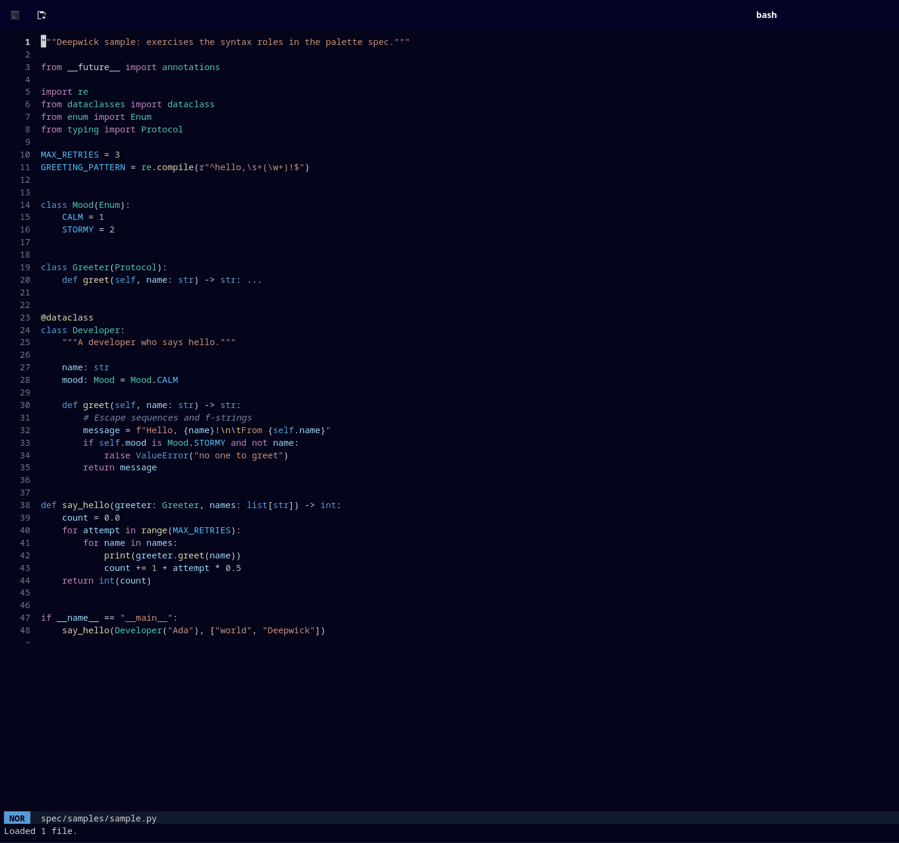

# Deepwick for Helix

A deep navy theme with Visual Studio 2022's syntax colors.

> Deepwick is an unofficial theme derived from
> [Polywick Blue](https://vscode.polywickstudio.net) by Polywick Studio (MIT).
> Not affiliated with Polywick Studio.



## Install

```sh
mkdir -p "${XDG_CONFIG_HOME:-$HOME/.config}/helix/themes"
cp deepwick.toml "${XDG_CONFIG_HOME:-$HOME/.config}/helix/themes/"
```

Then set the theme in `config.toml`:

```toml
theme = "deepwick"
```

or try it with `:theme deepwick`.

## Notes

- Tree-sitter without semantic tokens: no capture distinguishes interfaces,
  enums, and structs from other types, so the Mint role appears only where a
  language server supplies semantic tokens. Function-like macro definitions
  are Magenta; object-like macro names (`#define MAX 3`) get only the generic
  all-caps constant capture, so they are Cyan.
- Preprocessor directives are bold Foreground, in every language Helix gives
  a directive capture. The macro-definition capture (Magenta) is reused
  elsewhere: C++ `static_assert`, NASM pseudo-instructions, every GNU
  assembler instruction, Koka `initially`/`finally`, Clarity `define-*` forms
  and xtc `change_port`.
- Tree-sitter without per-language overrides: Python's `and`, `or`, `not`, `is`
  and membership `in` share the capture used for `typeof`/`new`, so they take
  the control-flow color; Python builtin types take the keyword color.

- Helix's Python grammar has no docstring capture, so docstrings are
  strings (Orange) rather than comments.
- The mode indicator is colored only with `color-modes = true` under
  `[editor]`.

Tested with Helix 25.07.1.

## License

MIT. See [LICENSE](LICENSE).
